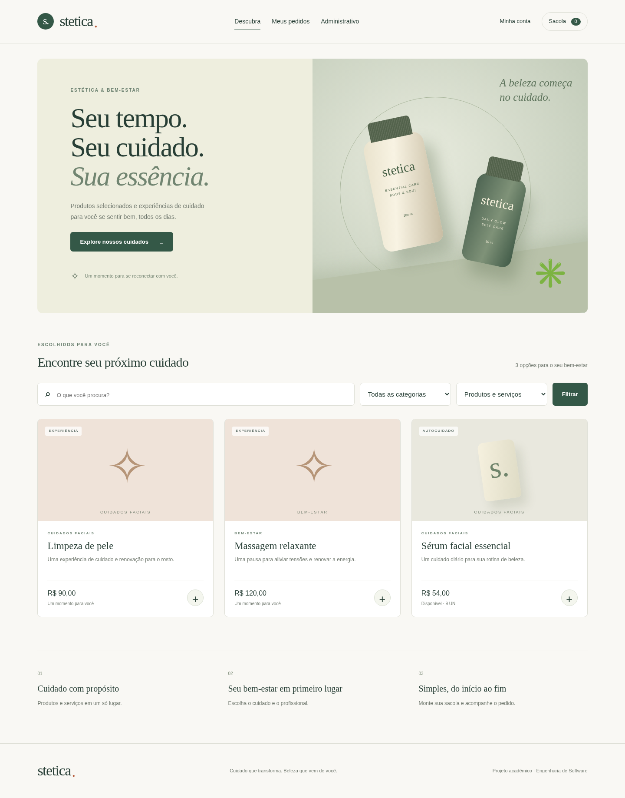

# Stetica

Aplicação acadêmica de Engenharia de Software para uma empresa de estética e bem-estar. Inclui loja de produtos e serviços, cadastro de clientes, carrinho, pedidos e painel administrativo, com persistência real no MySQL.

## Tecnologias e padronizações

- **Angular 17.3**, TypeScript, componentes standalone, `@if`/`@for`, formulários com validações e `HttpClient` separado em serviço.
- **ASP.NET Core / .NET 8**, Entity Framework Core 8 e provider Pomelo para MySQL.
- **Linguagem C# 8.0**, forçada por `<LangVersion>8.0</LangVersion>`. A versão da linguagem é diferente da versão do .NET. Não usa top-level statements, records ou namespaces de arquivo.
- Banco: **`bd_stetica`**, InnoDB, UTF-8 (`utf8mb4`).
- Interface responsiva autoral em verde sálvia, creme e terracota. As telas foram criadas neste projeto; não foi fornecido nem produzido um arquivo editável do Figma.

## Como executar em outro computador — passo a passo

Os comandos abaixo são para **Windows/PowerShell**. No macOS/Linux, os mesmos comandos `dotnet` e `npm` funcionam; substitua as barras dos caminhos por `/`. Não copie `node_modules`, `bin` ou `obj`: as dependências serão reinstaladas no computador de destino.

### 1. Instalar os programas

1. Instale o [SDK do .NET 8](https://dotnet.microsoft.com/download/dotnet/8.0), versão **8.0.400 ou superior da família 8.0**. Instale o SDK, não apenas o runtime.
2. Instale [Node.js 20](https://nodejs.org/en/download) com npm. O projeto fixa Angular 17 e foi validado com Node 20; evite trocar para Node 22/24 neste projeto.
3. Instale o [MySQL Community Server](https://dev.mysql.com/downloads/mysql/) **8.0 ou 8.4**, defina uma senha local e deixe o serviço iniciado na porta 3306.
4. Instale o [MySQL Workbench](https://dev.mysql.com/downloads/workbench/). O Workbench é o cliente; ele precisa de um MySQL Server instalado e iniciado.
5. Opcional: instale o VS Code ou Visual Studio 2022 com suporte ao .NET 8.

Abra um novo terminal e confira:

```powershell
dotnet --list-sdks
node --version
npm --version
```

Node deve mostrar `v20...` e a lista de SDKs deve conter `8.0.4...` ou feature band posterior de .NET 8. O arquivo `global.json` seleciona o SDK 8; o compilador permanece em C# 8.0.

### 2. Copiar o projeto

Extraia a pasta do projeto em um caminho de sua preferência, por exemplo `C:\Projetos\stetica`. Abra essa pasta no terminal. Ela deve conter `backend`, `frontend`, `database` e este README.

Se o código já estiver publicado no GitHub, também pode usar `git clone` e entrar na pasta clonada. Não é necessário usar Docker para executar no outro computador.

### 3. Criar o banco pelo MySQL Workbench

1. Abra sua conexão local no Workbench e informe a senha definida na instalação do MySQL.
2. Em **File → Open SQL Script**, abra **`database/01_bd_stetica.sql`**.
3. Execute o arquivo **inteiro**, usando o botão de raio para executar todas as instruções. A ordem de tabelas, função, triggers, views e procedure já está organizada.
4. Atualize o painel **Schemas** e confirme que existe **`bd_stetica`**.
5. Opcionalmente, abra e execute **`database/02_dados_demonstracao.sql`**. Ele adiciona categorias, um funcionário fictício, um produto com dez unidades, dois serviços e um cliente de demonstração. Conta fictícia: `cliente.demo@stetica.example`, senha pública de demonstração local `SteticaDemo@123`. Não cria acesso administrativo.
6. Confira:

```sql
USE bd_stetica;
SHOW TABLES;
SHOW TRIGGERS;
SELECT * FROM vw_produto_categoria;
```

**Compatibilidade:** o script não contém usuários `DEFINER`, caminhos locais, collation exclusiva `_0900` nem dumps dependentes de uma instalação específica. Foi executado e reexecutado no **MySQL 8.0.46 e 8.4**; os dados de demonstração também foram importados em ambas as versões. Não é possível garantir funcionamento em qualquer versão histórica do MySQL ou em MariaDB. A versão do Workbench não substitui a versão do servidor. O roteiro do projeto usa MySQL 8 para a aplicação.

O script não apaga tabelas ou dados. Sua reexecução recria as rotinas e views, mas **não migra tabelas antigas com outra estrutura**. Use um banco novo para esta primeira versão. Se já tiver `bd_stetica` com dados, faça backup e compare a estrutura antes de importar. Não execute os scripts antigos do ZIP junto com estes: eles usam outro nome/estrutura de banco.

### 4. Configurar e iniciar o backend

No terminal, a partir da pasta principal:

```powershell
cd backend\Stetica.Api
dotnet restore --locked-mode
```

Defina a conexão **com seu usuário e sua senha locais** e escolha uma chave administrativa própria com pelo menos 16 caracteres:

```powershell
dotnet user-secrets set "ConnectionStrings:Stetica" "Server=localhost;Port=3306;Database=bd_stetica;User=root;Password=SUA_SENHA_MYSQL;"
dotnet user-secrets set "Admin:Key" "SUA_CHAVE_ADMINISTRATIVA_COM_16_OU_MAIS_CARACTERES"
```

Os valores são locais ao usuário do computador, fora dos arquivos versionados. `appsettings.json` contém apenas campos vazios. Use outra conta MySQL se preferir; ela precisa de permissão para consultar e gravar em `bd_stetica`. Para a importação inicial, a conta usada no Workbench também precisa criar tabelas e rotinas.

Inicie a API em modo de desenvolvimento, necessário para ler os user-secrets:

```powershell
$env:ASPNETCORE_ENVIRONMENT = "Development"
dotnet build --no-restore
dotnet run --no-build --no-launch-profile --urls http://localhost:5080
```

Mantenha esse terminal aberto. Para conferir a conexão com o banco, em outro terminal:

```powershell
Invoke-RestMethod http://localhost:5080/api/saude
```

O retorno esperado contém `status: ok` e `banco: bd_stetica`. Essa verificação consulta uma tabela; testa mais do que a porta da API aberta.

No macOS/Linux, inicie com:

```bash
ASPNETCORE_ENVIRONMENT=Development dotnet run --no-build --no-launch-profile --urls http://localhost:5080
```

Alternativa aos user-secrets para automação: variáveis `ConnectionStrings__Stetica` e `Admin__Key`. Não é necessário usar ambas as formas. O backend recusa iniciar sem conexão configurada ou sem uma chave administrativa de pelo menos 16 caracteres.

### Swagger, Workbench e testes no Insomnia

Com a API iniciada em **Development**, abra `http://localhost:5080/swagger` no navegador do computador de destino. O documento OpenAPI fica em `/swagger/v1/swagger.json`.

Veja o [guia completo de Workbench, Swagger e Insomnia](docs/testes-api.md): importação do banco, dados fictícios, uso de **Authorize / Try it out**, login do cliente, criação de pedidos e conferência do estoque. A [coleção pronta do Insomnia](docs/insomnia/stetica.insomnia.json) contém 43 requisições; importe o arquivo e preencha as variáveis com seus IDs, chave e token. Também há um [OpenAPI exportado](docs/insomnia/stetica.openapi.json).

### 5. Iniciar o Angular

Abra **outro terminal** na pasta principal:

```powershell
cd frontend
npm ci
npm start
```

Abra `http://localhost:4200` no navegador **do computador onde o projeto está rodando**. O Angular encaminha `/api` para `http://localhost:5080` por meio de `proxy.conf.json`. Mantenha também esse terminal aberto. Para parar os servidores, use `Ctrl+C` em cada terminal.

Este guia executa Angular, API e MySQL juntos no computador de destino. Se decidir separar o banco ou a API em máquinas diferentes, será necessário ajustar conexão, proxy, origem CORS e regras da rede.

### 6. Usar a aplicação

1. Entre em **Administrativo** com a mesma chave definida em `Admin:Key`.
2. Se não importou os dados de demonstração, cadastre **categorias**, **funcionários** e **produtos/serviços**, nessa ordem.
3. Em **Entradas**, selecione o produto e informe quantidade, data e custo. O banco atualiza o estoque e o preço de venda.
4. Volte à loja em **Descubra**. Pesquise pelo nome, filtre por categoria/tipo e abra os detalhes dos itens.
5. Em **Minha conta**, crie uma conta de cliente com seus próprios dados e senha. CPF, telefone e CEP devem conter apenas dígitos; UF deve ter duas letras maiúsculas.
6. Adicione itens à **Sacola**, ajuste as quantidades dos produtos e selecione um funcionário por item. Serviços têm quantidade única e não usam estoque.
7. Confirme o pedido. Em **Meus pedidos**, consulte a situação e os detalhes. Cada cliente só consegue acessar os próprios pedidos pela sessão.
8. No administrativo, consulte o pedido e altere a situação: **Aberto → Em processamento → Concluído**. Antes da conclusão, é possível cancelar; o estoque dos produtos é devolvido uma única vez.

Não há cobrança ou integração de pagamento nesta versão. Clientes entram com e-mail e senha; funcionários não recebem uma conta automaticamente. O painel usa uma chave administrativa local compartilhada, suficiente para esta atividade, sem gestão individual de perfis administrativos.

### 7. Conferir builds e testes

Builds, a partir da pasta principal:

```powershell
dotnet build backend\Stetica.Api
cd frontend
npm run build -- --configuration production
```

O Angular gera `frontend/dist/stetica/browser`. Para desenvolvimento, continue usando `npm start`. Servir apenas os arquivos de produção não configura o proxy da API automaticamente.

Teste de integração opcional, com a API e o banco de desenvolvimento rodando e Python 3.9+ instalado. Em um terminal na **pasta principal**:

```powershell
$env:STETICA_TEST_ADMIN_KEY = "A_MESMA_CHAVE_CONFIGURADA_NA_API"
python tests\smoke.py
```

No macOS/Linux:

```bash
STETICA_TEST_ADMIN_KEY='A_MESMA_CHAVE_CONFIGURADA_NA_API' python3 tests/smoke.py
```

O teste cria dados fictícios identificados por execução e **não os apaga**; execute somente em banco de desenvolvimento. Verifica validações, permissões, cadastro/login, consultas por ID, estoque, pedidos, concorrência de compras, cancelamento e preservação do preço no histórico.

## Estrutura

```text
backend/Stetica.Api/     API, contratos, modelos EF e regras de negócio
database/               Criação do banco/rotinas e dados opcionais
frontend/src/           Aplicação Angular, componente de catálogo e serviço HTTP
docs/                   Modelo relacional, requisitos e imagens das telas
tests/smoke.py          Teste de integração real pela API
```

Consulte [o modelo e as decisões de banco](docs/modelo-relacional.md), [o escopo da atividade](docs/requisitos.md) e [os resultados de validação](docs/validacao.md).



## Problemas frequentes

| Sintoma | Como resolver |
| --- | --- |
| `dotnet` não encontrado | Instale o SDK, reabra o terminal e confira `dotnet --list-sdks`. |
| SDK do `global.json` não encontrado | Instale o SDK .NET 8.0.400 ou posterior da família 8.0. |
| `npm ci` falha ou Angular reclama do Node | Confirme Node 20, entre em `frontend` e use o lockfile que acompanha o projeto. |
| Backend pede conexão/chave | Execute `dotnet user-secrets set` dentro de `backend/Stetica.Api` e inicie com `ASPNETCORE_ENVIRONMENT=Development`. |
| MySQL `Access denied` | Confira usuário/senha/porta e acesso do usuário ao banco; o projeto não define uma senha padrão. |
| `Unknown database` ou tabela inexistente | Importe `01_bd_stetica.sql` inteiro no servidor usado pela conexão da API. |
| Erro ao criar função/trigger | Confira permissões da conta de importação. Em servidores administrados, peça ao administrador a criação das rotinas; não desative controles globais para contornar o erro. |
| Catálogo vazio | Importe os dados opcionais ou cadastre itens ativos e registre entradas para os produtos. |
| Sacola exige funcionário | Cadastre pelo menos um funcionário ativo no painel. |
| Erro de comunicação no navegador | Mantenha API na porta 5080 e Angular na 4200, em terminais separados. Confira `api/saude`. |
| Porta ocupada | Encerre outra instância; se mudar a porta da API, ajuste `frontend/proxy.conf.json` e reinicie Angular. |
| CPF/e-mail já cadastrado | Use dados diferentes ou edite o cadastro existente no painel. |
| Categoria não pode ser excluída | Há itens vinculados; essa restrição preserva o relacionamento do banco. |
| Pedido rejeitado por estoque | O saldo é revalidado no servidor; atualize o catálogo e ajuste a quantidade. |
