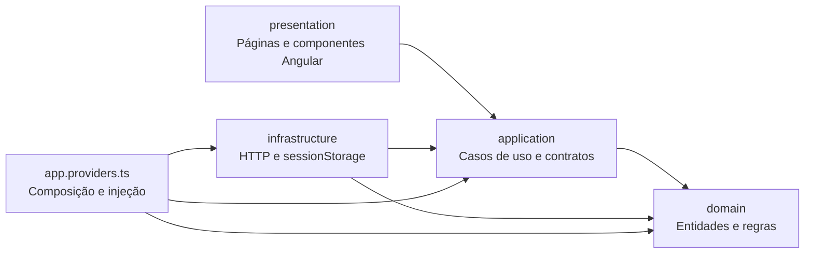

# Frontend — Clean Architecture

O frontend continua em Angular 17, com o mesmo contrato da API e o mesmo visual. O componente raiz agora contém o layout, a navegação e as mensagens compartilhadas. Catálogo, sacola, conta, pedidos e painel possuem páginas próprias, carregadas sob demanda pelo Angular Router.

## Dependências



`domain` e `application` não importam Angular, RxJS, HTTP, páginas ou APIs de navegador. Os casos de uso recebem interfaces de repositório e sessão por construtor. A infraestrutura implementa essas interfaces, e `app.providers.ts` escolhe as implementações na inicialização. Assim, testes podem usar memória e repositórios falsos sem iniciar Angular, API ou banco.

A apresentação chama os casos de uso. Ela não monta URLs da API, não instancia adapters e não acessa `sessionStorage`. Detalhes do Angular, navegação, formulários, máscaras visuais e mensagens ficam nessa camada.

## Organização

```text
frontend/
  src/
    domain/
      models.ts                 Entidades e tipos de negócio
      cart.ts                   Quantidade, estoque local, serviços e total
      order-status.ts           Transições de situação
      errors.ts                 Erros de regras de negócio
    application/
      ports.ts                  Interfaces de repositórios e sessão
      contracts.ts              Comandos e projeções de leitura
      *.use-cases.ts            Catálogo, conta, carrinho, pedidos e painel
      errors.ts                 Erros de aplicação e sessão requerida
    infrastructure/
      http-api.client.ts        HttpClient, cabeçalhos e tradução de erros HTTP
      http-*.repository.ts      Implementações dos repositórios da API
      browser-session.store.ts  Adapter para sessionStorage
    presentation/
      pages/
        catalog/                Catálogo, filtros e detalhes de item
        cart/                   Sacola e confirmação
        account/                Cadastro e login
        orders/                 Pedidos do cliente
        admin/                  Painel, tabelas e formulários de manutenção
      shared/                   Cartão de item, detalhes, mensagens e formatação
    app.component.*             Layout compartilhado
    app.providers.ts            Composition root e factories de injeção
    app.routes.ts               Rotas e carregamento sob demanda
    main.ts                     Inicialização Angular
  tests/                        Testes sem navegador e verificação de dependências
  e2e/                          Fluxos reais com Playwright
```

O painel usa uma projeção tipada de leitura (`AdminRow`/`AdminDetail`) para tabelas e detalhes. A gravação usa comandos específicos (`PersonInput`, `ItemInput`, `EntryInput` etc.). O mapper do formulário monta somente os campos do comando: não envia o objeto inteiro recebido da API de volta ao servidor.

## Fluxo de uma compra

1. A página de catálogo chama `CatalogUseCases`. O repositório HTTP consulta itens, categorias e equipe.
2. A seleção é entregue a `CartUseCases`, que delega as regras ao domínio `Cart`: produto exige saldo, serviço só pode aparecer uma vez e tem quantidade 1. O total local é calculado em centavos.
3. A página da sacola permite ajustar quantidade e funcionário. O carrinho pertence à aplicação, então continua disponível ao navegar entre páginas, inclusive durante o cadastro do cliente.
4. `CartUseCases.checkout()` exige sessão, itens e funcionário, e envia apenas IDs e quantidades ao repositório de pedidos. Preço e total finais vêm do backend.
5. Enquanto a confirmação está em andamento, a aplicação bloqueia novas confirmações e alterações da sacola, inclusive se o usuário navegar e voltar. Se a confirmação falhar, o carrinho é preservado. Somente a resposta bem-sucedida limpa os itens e abre os detalhes do pedido.
6. O painel usa o caso de uso de pedidos para alterar a situação. O domínio rejeita transições inválidas localmente; o backend continua validando autorização, situação atual, transações e estoque.

As regras locais melhoram a interação, mas **o backend continua sendo a autoridade para estoque, preços, permissões e persistência**. Nenhuma alteração no contrato ou código do backend foi necessária para esta refatoração.

## Sessão e erros

`SessionStore` é uma interface da aplicação. Seu adapter mantém as chaves existentes (`stetica-token`, `stetica-cliente` e `stetica-admin`) no `sessionStorage` da aba. JSON de sessão inválido é descartado em vez de impedir a abertura da loja.

O caso de uso de login só salva a sessão depois da confirmação da API. A chave administrativa também é persistida somente após ser validada. No logout, a sessão local é removida mesmo se a rede falhar.

O adapter HTTP transforma erros de transporte e de validação do ASP.NET em `ApplicationError`. A apresentação recebe mensagens e status, sem depender de `HttpErrorResponse`.

O carrinho é temporário em memória e é perdido ao recarregar a página. Pedidos confirmados continuam no MySQL. Não foram adicionados persistência local do carrinho, novos perfis de acesso ou mudanças nas regras da API.

## Rotas

| Caminho | Página |
| --- | --- |
| `/` | Catálogo |
| `/carrinho` | Sacola |
| `/conta` | Cadastro, login e conta |
| `/pedidos` | Histórico do cliente |
| `/admin` | Painel administrativo |

Recarga e botão voltar funcionam com o servidor de desenvolvimento (`npm start`). Se hospedar o build de produção, configure o servidor para encaminhar as rotas do frontend para `index.html` e as chamadas `/api` para o backend.

## Testes

Na pasta `frontend`, com Node 20 e dependências instaladas por `npm ci`:

```bash
npm test
npm run typecheck
npm run build -- --configuration production
```

`npm test` compila os testes com TypeScript e usa o runner nativo do Node. Não exige banco nem navegador. Os testes cobrem regras do carrinho, preservação da sacola em falhas, montagem do pedido, sessão, autenticação administrativa e transições de situação. Também verificam os imports das camadas internas e impedem dependência da apresentação em HTTP/adapters/armazenamento.

Para testes completos no navegador, mantenha MySQL, API e Angular rodando conforme o README. Na pasta `frontend`, em outro PowerShell:

```powershell
npx playwright install chromium
$env:STETICA_TEST_ADMIN_KEY = "A_MESMA_CHAVE_CONFIGURADA_NA_API"
npm run test:e2e
```

No macOS/Linux:

```bash
npx playwright install chromium
STETICA_TEST_ADMIN_KEY='A_MESMA_CHAVE_CONFIGURADA_NA_API' npm run test:e2e
```

O endereço padrão é `http://localhost:4200`. Para outro endereço, configure `STETICA_UI_URL`. Se já tiver um Chromium compatível instalado, pode usar `STETICA_CHROMIUM_PATH` com o caminho do executável, em vez de baixar o navegador. Foi essa a alternativa usada no ambiente de nuvem.

Os testes de navegador criam sua própria categoria, funcionário, produto, serviço e cliente fictícios. Devem ser executados somente em banco de desenvolvimento. Eles desativam os produtos e o funcionário ao terminar; mantêm registros e histórico para inspeção. Não configuram sua chave nem iniciam automaticamente os servidores. Chaves e tokens reais não estão versionados. Relatórios e saídas de compilação de teste são ignorados pelo Git.

## Acrescentar uma funcionalidade

Defina os modelos/regras no domínio, o caso de uso e contrato na aplicação, e o adapter HTTP na infraestrutura. Registre a implementação em `app.providers.ts` e exponha a funcionalidade em uma página ou componente da apresentação. Se criar uma página, registre sua rota em `app.routes.ts`. Cubra regras com repositórios em memória e, quando necessário, acrescente um fluxo em `e2e`.
