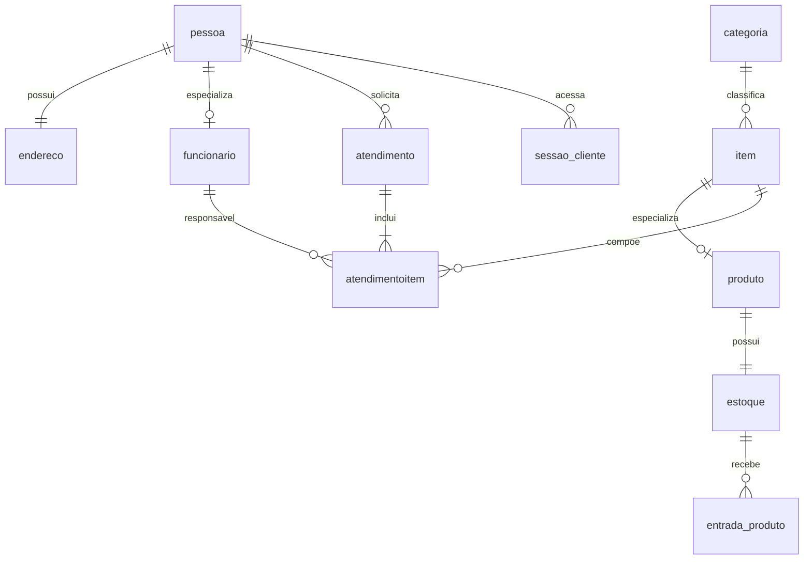

# Modelo relacional — bd_stetica

A base conceitual vem das dez entidades do material da atividade: pessoa, endereço, funcionário, categoria, item, produto, estoque, entrada de produto, atendimento e itens de atendimento. A pedido do usuário, o modelo executável foi criado neste projeto com o nome `bd_stetica`.

## Diferenças em relação ao SQL de exemplo

- CPF e telefone são textos, preservando zeros à esquerda. CPF tem formato de 11 dígitos; a API não consulta a Receita Federal nem valida a existência do documento. CPF e e-mail têm índices únicos.
- Endereço inclui logradouro, bairro, cidade e UF, além de CEP, número e complemento; não depende de serviço externo de CEP.
- Situação de pessoa/item usa booleano. Pedido armazena situação por nome, data/hora e total.
- `senha_hash` em pessoa e `sessao_cliente` dão suporte à identificação dos clientes. Senhas usam PBKDF2-SHA256 com salt aleatório e 210.000 iterações; só o hash dos tokens de sessão é guardado. Sessões expiram em 12 horas.
- O item de atendimento guarda preço unitário da compra; mudanças futuras no catálogo não reescrevem o histórico.
- Cada item do pedido tem funcionário responsável. Serviços usam quantidade 1 e não possuem linha em estoque. Produtos/funcionários/clientes são desativados em vez de apagados; categorias só são excluídas quando não possuem itens.
- Cada pessoa tem um endereço; produto e funcionário usam a mesma chave do registro-base correspondente.

## Integridade das movimentações

- A criação de produto aciona um trigger que abre estoque com saldo zero.
- Uma entrada aciona trigger que soma o saldo e atualiza custo e venda. A função `fn_calc_preco_venda` aplica margem de 4%, 8% ou 10%, conforme código 1, 2 ou 3. A API chama essa mesma função ao cadastrar/editar produto.
- O pedido é gravado em transação. O trigger de itens verifica disponibilidade e debita saldo de forma condicional, impedindo saldo negativo em compras concorrentes. A falha de qualquer linha desfaz o pedido inteiro.
- Cancelamento bloqueia o cabeçalho do pedido dentro de uma transação e devolve os produtos em ordem de ID. O mesmo pedido não pode ser cancelado duas vezes nem cancelado depois de concluído.
- A API é a entrada suportada para pedidos e alterações de situação. Alterações manuais de status pelo Workbench não executam a regra de devolução implementada no backend.

O SQL inclui cinco views de consulta e a procedure `sp_estoque_por_item`. A maioria das consultas/cadastros da aplicação usa EF Core; não é necessário executar as procedures antigas da aula. O script é uma instalação inicial, não um sistema de migrações. Estruturas do banco antigo não devem ser misturadas com esta versão.
